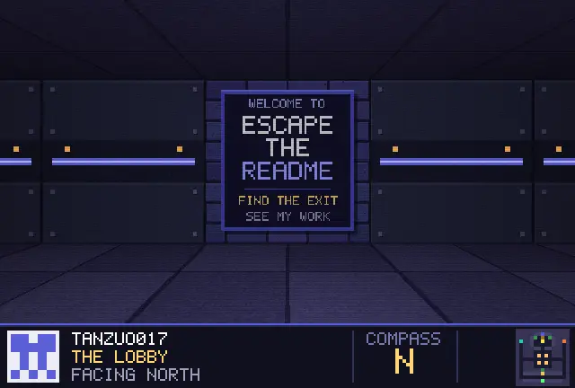

  

 

  
   
  ▶ <b><a href="https://github.com/tanzuo017/escape-the-readme/blob/main/play/start.md">Click to play <i>Escape the README</i></a></b>, a first-person maze that runs inside GitHub. 
  No JavaScript, no server: just 288 pre-rendered views linked together. My projects are hanging on the walls.

 

## 👋 Hey, I'm Tanzim

I build digital tools for public health at **Project Q2**.

- 🩺 Turning paper clinical records into clean, structured data, in English **and** বাংলা
- 📈 Making outbreak data readable: curves, heat maps, plain language
- 🎮 Currently hiding my portfolio inside a maze (see above)

## 🗂️ Featured work

<table>
<tr>
<td width="50%" valign="top">

### [🩺 NTEST](https://github.com/tanzuo017/NTEST-clinical-digitization-tool)

A bilingual (English / বাংলা) data-entry tool for WHO PEN diabetes outpatient records. It was built to run a timed usability comparison against paper→Excel and Google Forms: keyboard-only flow, live entry timer, CSV export.

`React` `Tailwind` `i18n` `usability research`

</td>
<td width="50%" valign="top">

### [📣 Find Every Child](https://github.com/tanzuo017/find_a_child)

The campaign site for Project Q2's response to the 2026 measles outbreak in Bangladesh, with an outbreak curve, a division-level heat map and a fundraising tracker. The whole thing is one self-contained HTML file.

`HTML` `data viz` `maps` `storytelling`

</td>
</tr>
<tr>
<td colspan="2" valign="top">

### [🕹️ Escape the README](https://github.com/tanzuo017/escape-the-readme)

The game at the top of this page. It's a NumPy raycaster that pre-renders every position in the maze, so GitHub's markdown viewer becomes the game engine.

`Python` `NumPy` `raycasting` `procedural pixel art`

</td>
</tr>
</table>

## 🧰 Toolbox

  
  
  
  
  
  
  

## 🤝 Find me

  
  

 

  
   
  Still here? <a href="https://github.com/tanzuo017/escape-the-readme/blob/main/play/start.md">The exit is somewhere in the maze.</a>

